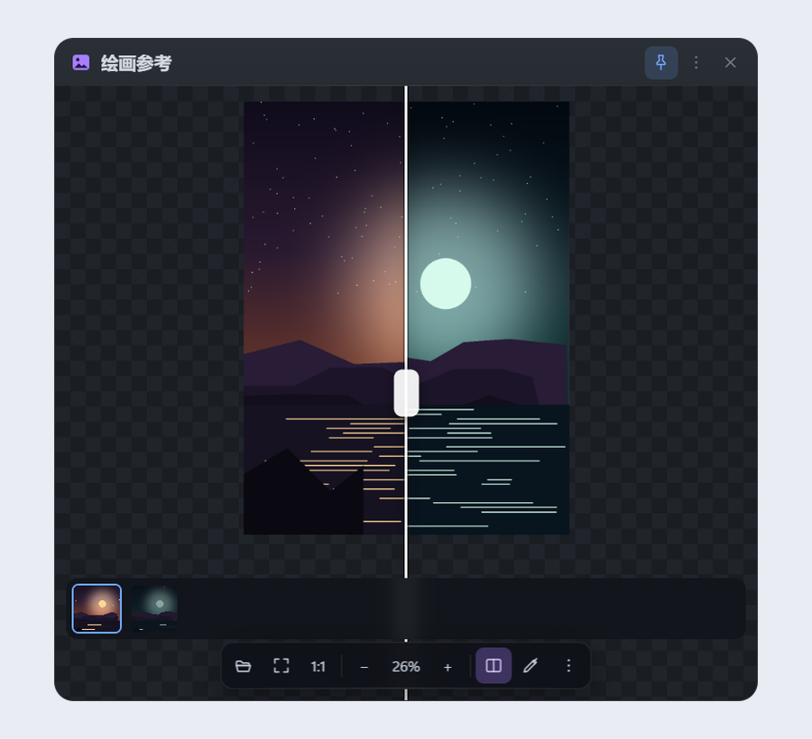
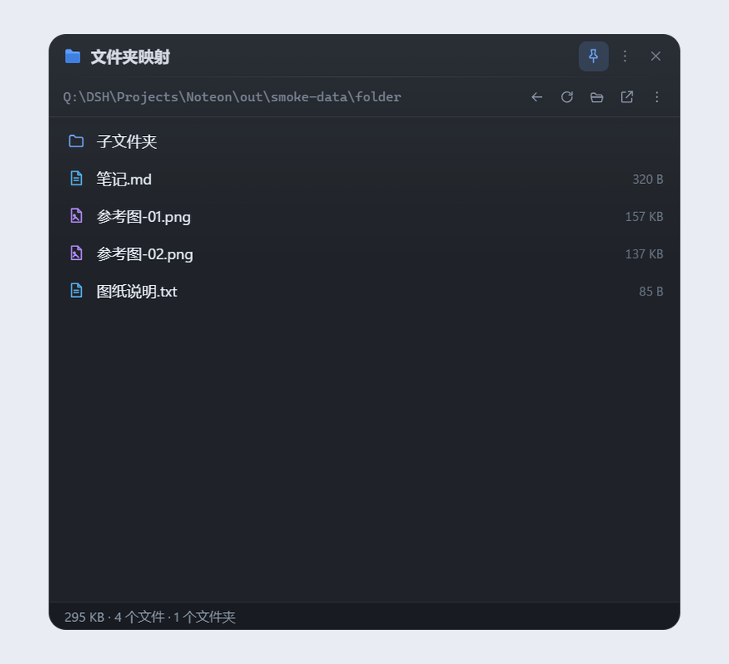
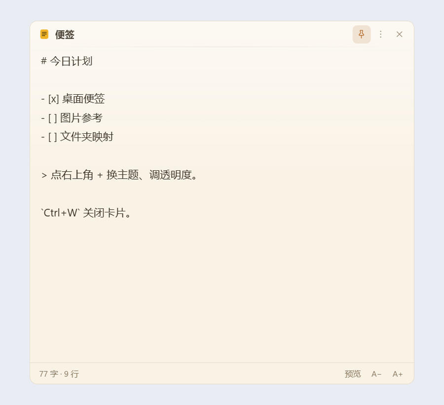

# Noteon

> 一个桌面便签工具，也是一个「卡片容器」。  
> 每张卡片都是独立、无边框、可置顶的小窗口；卡片里能做什么，由插件决定。


## 它是什么

- **桌面悬浮卡片**：无边框、透明、可置顶、可任意缩放、可吸附对齐，位置和大小自动记住。
- **内容插件化**：卡片本身只是一个容器。内置 7 个插件，也可以自己写一个放进 `plugins/`。
- **本地优先 / 便携**：所有数据都在程序目录的 `data\board.json`，不联网、不上传。

| 插件 | 能做什么 |
| --- | --- |
| 便签 | 随手写，Markdown 预览，自动保存 |
| 文本 | 打开 / 编辑 txt、md、代码，自动保存，可拖入文件 |
| 图片 | 滚轮缩放、拖动、多图、分割对比、三分网格、水平翻转；双击图片进入纯图模式，右键取色（双击右键复制色值） |
| 截屏 | 拖动框选区域或全屏截取，裁剪 / 旋转 / 翻转 / 画笔编辑，`Ctrl+S` 快速保存到 `data\shots`，或直接生成图片卡片 |
| 文件夹映射 | 把一个文件夹钉在桌面，浏览、打开、拖入文件即复制 |
| 网页 | 贴一个网址或本地 HTML，带地址栏、前进后退、缩放 |
| 文件中转 | 暂存文件，再拖到桌面 / 聊天窗口 / 任意软件 |




## 运行

需要 Windows。**发布页的 [Noteon-win64.zip](https://github.com/SGorgeous/Noteon/releases/latest) 已内置 Electron 运行时**，解压后直接双击 `Noteon.exe`，不用装 Node。

源码仓库为了控制体积没有提交 `runtime/`（约 357MB）：

- 想从源码运行：把 Electron 运行时解压到 `runtime/electron/`（或从 Release 包里复制 `resources` 外的运行时文件），然后双击 `Noteon.cmd`
- **`Noteon.cmd`** —— 带控制台启动，方便看日志
- **`Noteon.vbs`** —— 无控制台窗口
- 开发模式：`dev.cmd`（带 `--enable-logging`）

首次启动会打开控制台，并放一张欢迎便签。之后从托盘图标右键，或控制台里新建卡片。

> 程序常驻托盘。关掉所有卡片不会退出；要退出请用托盘菜单「退出 Noteon」。

## 操作

| 操作 | 方式 |
| --- | --- |
| 移动卡片 | 拖标题栏 |
| 缩放卡片 | 拖左右边、底边或底角（离边框 6px 内） |
| 置顶 / 取消 | 标题栏图钉，或卡片 `⋯` 菜单 |
| 换主题 / 透明度 / 重命名 | 卡片右上角 `⋯` |
| 鼠标穿透（锁定） | 卡片 `⋯` → 鼠标穿透；从托盘「解除全部鼠标穿透」恢复 |
| 隐藏卡片 | 标题栏眼睛图标，或 `Ctrl+H`；从托盘「显示全部卡片」或控制台「显示」恢复 |
| 关闭卡片 | 标题栏 ×，或 `Ctrl+W` |
| 显示 / 隐藏全部 | 托盘菜单 |
| 桌面模式 | 卡片 `⋯` → **桌面模式（不置顶）**；托盘「全部桌面模式 / 全部取消桌面模式」 |
| 纯图模式（图片卡片） | 双击图片隐藏所有 UI，只留图片；再双击或 `Esc` 恢复 |
| 图片取色 | 在图片上右键取色；双击右键复制颜色值（不含 `#`） |
| 全部显示并排列 | `Ctrl+Alt+N`，或托盘菜单「显示全部并排列」；在当前显示器排成网格 |
| 吸附对齐 | 拖动时靠近屏幕边缘或其它卡片自动吸附（可在设置里关） |

## 资源管理器右键菜单

桌面或文件夹空白处右键 → **在 Noteon 新建** → 选择便签 / 文本 / 截屏 / 图片 / 文件夹映射 / 网页 / 文件中转。

- 在文件夹空白处右键时，「文件夹映射」会自动映射当前文件夹
- Windows 11 的新版右键菜单会把第三方项目收在 **「显示更多选项」** 里（也可以直接按 `Shift+F10`）
- 便携版首次启动会自动注册到**当前用户**的资源管理器（不写系统级），控制台 → 设置 → **资源管理器右键菜单** 里可以关闭

## 主题

6 套预设：墨夜、雾白、纸页、极光、樱粉、林间。  
控制台「主题」里可以调强调色、背景色、不透明度、圆角、背景模糊；全局实时生效。  
单张卡片可以在自己的 `⋯` 菜单里单独换预设 / 透明度，不会被全局覆盖掉。



## 目录

```
main/        主进程：窗口 / 卡片 / 插件宿主 / 协议 / 托盘
renderer/    卡片壳、控制台、共享主题与图标
plugins/     每个插件一个目录：plugin.json + index.js + style.css + icon.svg
assets/      应用图标、托盘图标
tools/       图标生成、示例数据、鼠标自动化测试
docs/        使用与插件开发文档
runtime/     离线 Electron（不进版本库）
data/        卡片数据、缓存 —— 运行时生成，整个文件夹可搬走
```

## 插件

卡片壳只负责窗口、拖动、缩放、主题、持久化和 `ctx.api`；插件拿到一个 DOM 根节点，想放什么放什么。

```js
// plugins/hello/index.js
Noteon.define({
  id: 'hello',
  mount(ctx) {
    const { root, api } = ctx;
    root.innerHTML = '<h1>你好</h1>';
    api.setStatus('hello plugin');
    return { unmount() {} };
  },
});
```

完整字段、`ctx.api` 清单和主进程钩子见 [docs/插件开发.md](docs/插件开发.md)。

## 数据

| 内容 | 位置 |
| --- | --- |
| 卡片、位置、主题、插件设置 | `<Noteon 目录>\data\board.json` |
| 远程图片缓存 | `<Noteon 目录>\data\cache\` |
| 日志（开发模式） | 控制台输出 |

重置：退出 Noteon 后删除程序目录下的 `data` 文件夹即可。

数据全部在程序目录内（便携），不会写到 C 盘；从旧版本升级时，首次启动会自动把 `%APPDATA%\Noteon\board.json` 迁移过来并清理旧目录。

## 已知边界

- 目前只针对 Windows 调优；代码里没有平台硬编码，但未在 macOS / Linux 验证。
- 网页卡片使用原生 `WebContentsView`，网页区域不能和卡片自身的半透明圆角叠加，所以底部留了一条 18px 状态条盖住圆角。
- 网页卡片不支持鼠标穿透（会挡住网页本身的交互）。
- 文件拖出一次只能拖一个（Electron `startDrag` 的限制）；多选请用「复制路径」。
- 尚未打包成安装包；需要 EXE / APK 时再说。

## 开发

```bat
:: 冒烟测试：建 6 张示例卡、截图、跑拖动/缩放/置顶自测，然后退出
runtime\electron\electron.exe . --smoke

:: 示例数据
python tools\make_smoke_data.py

:: 图标
python tools\make_icons.py
```

`--demo` 会建同样的卡片但不退出，方便肉眼调 UI。
